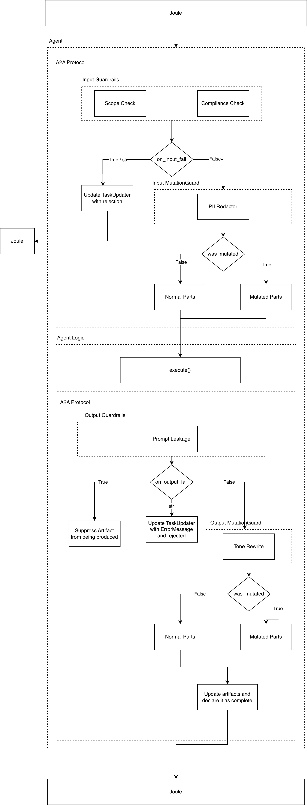

# Architecture

## Overview

Aegis has two execution modes — `Guard` and `MutationGuard` — both with the same fluent
`.use()` API. Choose based on whether you need to **detect** issues or **fix** them.

---

## Guardrail Lifecycle

The diagram below shows the intended integration pattern for a full A2A agent request cycle.



The validators named below are illustrative — Aegis ships built-in validators (see
[Validators](validators/index.md)), and you can also supply your own (see
[Custom Validators](custom-validators.md)).

**Input phase:**

1. **Input Guardrails (`Guard`)** — e.g. a content filter and a PII detector run concurrently.
   - If any fails → propagate to `TaskUpdater` with a rejection message and fail the task.
   - If all pass → continue to input mutation.
2. **Input MutationGuard** — e.g. a PII redactor sanitizes the incoming message before it reaches `execute()`.

**Output phase:**

3. **Output Guardrails (`Guard`)** — e.g. a prompt-leakage check on the agent's response.
   - If fails → suppress the artifact or update `TaskUpdater` with an error message.
   - If passes → continue to output mutation.
4. **Output MutationGuard** — e.g. a tone normalizer rewrites the tone before the response is returned.

---

## Design Principles

These principles explain why the library behaves the way it does.

**Detect, don't mutate (Guard)**
: `Guard` validators only return `PassedResult` or `FailedResult`. They never modify the input.
This makes concurrent execution safe — no validator can affect another's input.

**Mutation is explicit (MutationGuard)**
: Only `MutationGuard` can transform values, via validators that implement `mutate()`.
Detection and mutation are separate concerns with different execution semantics.

**No value chaining in Guard**
: All `Guard` validators receive the original input simultaneously via `asyncio.gather()`.
A later validator cannot see an earlier validator's side effects.

**On-fail handlers are void**
: `on_fail` callbacks are side-effect only — log, notify, raise. They never return a
transformed value. Value transformation belongs in `MutationGuard`.

**Validators are pluggable — built-in or your own**
: Aegis ships a set of built-in validators (see [Validators](validators/index.md)), and the
engine runs any validator satisfying a structural protocol (`Validator` / `MutationValidator`)
or subclassing `BaseValidator` / `BaseMutationValidator`, so you can add your own too. Integrate
explicitly via `Guard`/`MutationGuard` for full control, or use the A2A executor wrapper for a
simpler drop-in experience. The underlying API stays the same either way.

**Protocol-first validators**
: Validators satisfy a structural protocol (`Validator` / `MutationValidator`). Any class
with the right methods qualifies — no forced inheritance. `BaseValidator` and
`BaseMutationValidator` are opt-in convenience base classes.

---

## Why Separate Validators?

Guardrails can theoretically be embedded directly into an agent's system prompt as behavioral
instructions. Aegis takes the opposite approach — all validators run as independent calls,
outside the agent. Here's why.

**Reliability — the primary reason**
: Prompt instructions are suggestions, not guarantees. Under adversarial pressure (prompt
injection, jailbreak, multi-turn escalation), a model can ignore embedded instructions. A
guardrail that can be bypassed has no value when it matters most. Separate validators enforce
independently — a deterministic check cannot be talked out of doing its job.

**Reusability**
: One validator definition, used by any agent that needs it. Change once, apply everywhere.
Embedding guardrail logic in prompts means copying and maintaining it in every agent separately.

**Testability**
: Each validator can be unit tested in isolation with known inputs and expected `PassedResult` /
`FailedResult` outputs — without involving the full agent. Embedded validators are entangled with
agent business logic and cannot be tested or benchmarked independently.

**Auditability**
: Separate validators produce structured results: which validator fired, what it caught, and the
full `FailedResult` with details. Embedded validators are a black box — there is no trace of why
the agent did or didn't enforce a rule.

---

## Guard: Concurrent Detection
Input ──┬── Validator A ──┬── GuardResult
        ├── Validator B ──┤   .results
        └── Validator C ──┘   .has_failures
                               .failures
```

- All validators run simultaneously via `asyncio.gather()`.
- Returns `GuardResult` — inspect `has_failures` and `failures`.
- Values are **never** modified.
- Each validator gets an `on_fail` action: `LOG` (default), `EXCEPTION`, `NOOP`, or a custom callable.

```python
from aegis import Guard, OnFailAction

guard = (
    Guard("input-guard")
    .use(ValidatorA(), on_fail=OnFailAction.EXCEPTION)
    .use(ValidatorB(), on_fail=OnFailAction.LOG)
    .use(ValidatorC())  # defaults to LOG
)

result = await guard.validate(value="some input")
print(result.has_failures)   # bool
print(result.failures)       # list[FailedResult]
```

---

## MutationGuard: Sequential Mutation Pipeline

```
Input ──► Validator A ──► [mutate A] ──► Validator B ──► [mutate B] ──► output
          validate()         │            validate()         │
          FailedResult? ───────┘            FailedResult? ───────┘
```

- Validators run in registration order.
- When a validator returns `FailedResult`, its `mutate()` is called immediately.
- The mutated value is passed to the next validator (each sees the previous output).
- Returns `MutationGuardResult`:
  - `was_mutated` — `True` if any edit was applied
  - `output` — the final content, mirroring the input type: a `str` when called with a `str`, otherwise a `ContentView` (same item count and order as the input); call `.render()` for text
  - `results` — list of all `ValidationResult`s

```python
from aegis import MutationGuard

guard = (
    MutationGuard("output-guard")
    .use(ValidatorA())
    .use(ValidatorB())
)

result = await guard.validate("some output")
final = result.output          # always the final content — str in → str out, mutated or not
# result.was_mutated only tells you *whether* anything changed (e.g. for logging).
```

---

## Decision Guide

| Aspect | Guard | MutationGuard |
|---|---|---|
| Execution | Concurrent | Sequential |
| Mutation | Never | When validator fails |
| Return type | `GuardResult` | `MutationGuardResult` |
| `on_fail` param | Yes (LOG / EXCEPTION / NOOP / callable) | No |
| Typical use | Input validation, compliance, scope checking | Output sanitization, PII redaction, tone correction |

**Use `Guard` when** you need to decide whether to proceed with a request — the content is accepted or rejected as-is.

**Use `MutationGuard` when** you want to clean up content before passing it on — the content is acceptable but needs transformation.

---

## Combining Both

A typical executor uses both: a `Guard` to gate input, a `MutationGuard` to clean output.

```python
from aegis import Guard, MutationGuard, OnFailAction, ValidationError
from aegis.validators.detection import ContentFilter
from my_validators import MaxLength, PIIRedactor  # your own validators

# Built once, reused across requests
input_guard = (
    Guard("input")
    .use(MaxLength(5000), on_fail=OnFailAction.EXCEPTION)
    .use(ContentFilter(blocked_topics=["fraud"]), on_fail=OnFailAction.EXCEPTION)
)

output_guard = MutationGuard("output").use(PIIRedactor())

# In your executor:
async def execute(request, task_updater):
    try:
        await input_guard.validate(value=request.message)
    except ValidationError as e:
        await task_updater.submit(message_with_text(f"Request rejected: {e.result.error_message}"))
        await task_updater.failed()
        return

    response = await your_agent_logic(request)

    out = await output_guard.validate(response)
    final_response = out.output          # str in → str out; already the final content
    await task_updater.submit(message_with_text(final_response))
    await task_updater.complete()
```

See [Cookbook](cookbook.md) for more integration patterns including full executor examples.
